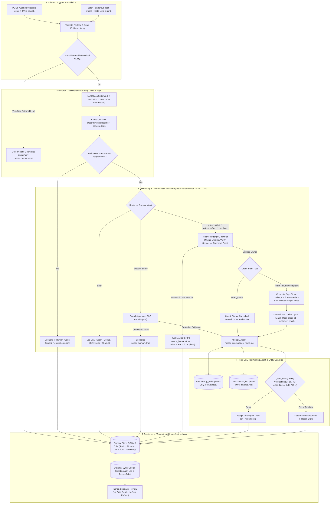
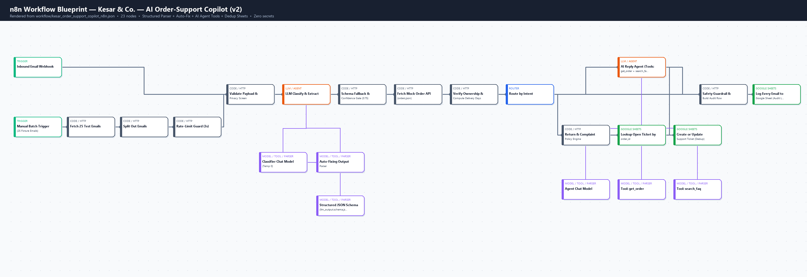
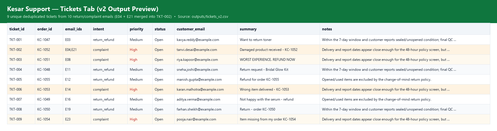
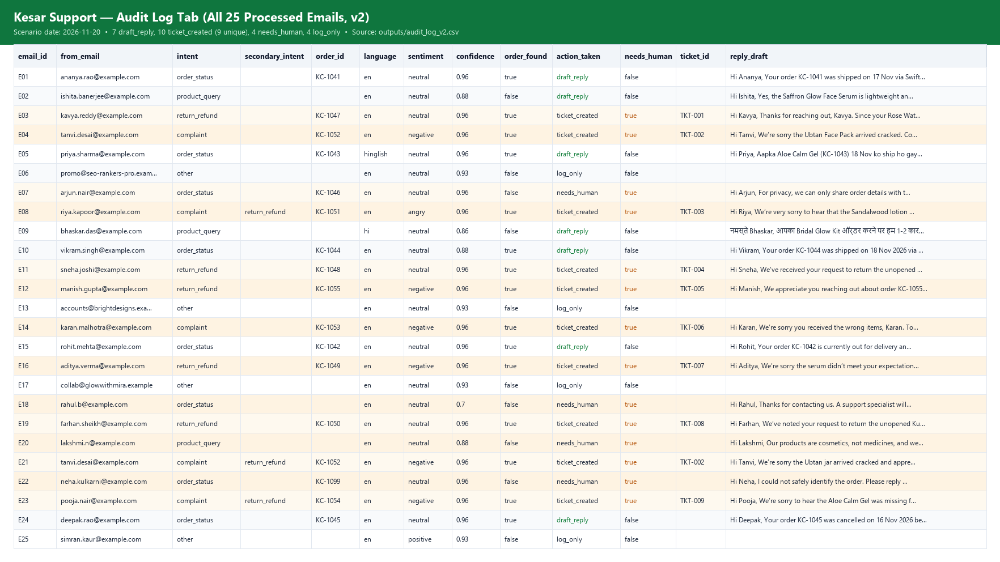

# Kesar & Co. Support Copilot — AI Automation Submission

> **Honest status upfront:** This repository contains **(1)** a complete, importable **n8n workflow blueprint** ([`workflow/kesar_order_support_copilot_n8n.json`](workflow/kesar_order_support_copilot_n8n.json)) with zero embedded secrets, **(2)** a fully runnable, zero-dependency **Python 3.10+ reference engine, HTTP webhook, and Google Sheets adapter** ([`kesar_copilot/`](kesar_copilot/), [`webhook.py`](webhook.py)), and **(3)** **74 automated unit and integration tests**. Because this package was generated without live third-party credentials in the environment, live LLM API calls and live Google Sheets writes are mock-tested rather than executed against a hosted account; connect your own free-tier key and Google Sheet (see §3) + link your 5-minute Loom before sending.

---

## 1. Summary

- **What I built (2–3 lines):** An order-support copilot for Kesar & Co. that validates inbound emails, classifies intent/entities against `schemas/llm_output.schema.json` (with automatic JSON repair + deterministic safety cross-checks), verifies checkout-email ownership, deduplicates support tickets for returns/complaints, drafts grounded replies in English/Hindi/Hinglish via a read-only tool-calling agent (`lookup_order` + `search_faq`), and logs every email with token/cost telemetry.
- **Platform and LLM used:** **n8n** workflow export ([`workflow/kesar_order_support_copilot_n8n.json`](workflow/kesar_order_support_copilot_n8n.json)) + **Python 3.10+** local execution engine. Supports any OpenAI-compatible Chat Completions endpoint (`gpt-4o-mini`, `gemini-2.5-flash`, `llama-3.3-70b-versatile`).
- **Submission links (fill before emailing):**
  - **Google Sheet (view access):** `<PASTE_YOUR_SHARED_GOOGLE_SHEET_LINK_HERE>` *(or generate immediately via `python run.py --version v2 --sync-sheets`)*
  - **5-minute walkthrough video:** `<PASTE_YOUR_LOOM_OR_UNLISTED_YOUTUBE_LINK_HERE>`
- **What works / what doesn't:**
  - **Works:** All 25 fixture scenarios (`v1` → `v2` iteration), strict sender-email privacy gate (`E07`), prompt-injection defense (`E12`), medical escalation (`E20`), Hindi/Hinglish replies (`E09`, `E05`), ticket deduplication with follow-up notes (`E04`+`E21` → `TKT-002`), all-8-product FAQ grounding, exponential backoff retries, SQLite idempotent webhook, and mock-tested Google Sheets upsert.
  - **Doesn't / Honest limits:** Live external LLM and Google Sheets API calls require user credentials; `orders.json` lacks hour-level delivery timestamps (48h damage window is date-screened and routed to human); attachment filenames (`E21`) are not image bytes and cannot be visually inspected.

---

## 2. Architecture

### System Architecture Diagram (Mermaid)



### n8n Workflow Canvas



### Output Previews (`Tickets` & `Audit Log`)

| Tickets Tab (`9` deduplicated tickets) | Audit Log Tab (`25` processed emails) |
|---|---|
|  |  |

### Major Workflow Steps & Design Rationale

| Step / Node | What it does | Why I designed it this way |
|---|---|---|
| **1. Trigger (`Webhook` or `Batch Loop` + `Wait`)** | Accepts `POST` JSON per email (`webhook.py` / n8n Webhook) or iterates over `data/test_emails.json` with rate-limit spacing. | Supports both real-time webhook replay (`scripts/send_test_emails.py`) and one-click batch evaluation without hitting free-tier `429` limits. |
| **2. Payload Validation & Medical Privacy Screen** | Normalizes email headers/timestamps, enforces `email_id` idempotency, and flags medical/skin-condition terms (`eczema`, `psoriasis`, `acne`, `pregnancy`, `allergy`). | Fails fast on malformed payloads and prevents sensitive health disclosures from being sent to external LLM APIs (`E20`). |
| **3. LLM Classify & Extract + Auto-Repair** | Calls LLM (`temperature=0`) using [`prompts/classification.md`](prompts/classification.md) + `schemas/llm_output.schema.json`, retrying transient `429`/`5xx` errors and running a 1-turn JSON repair prompt if validation fails; falls back safely to deterministic rules. | Guarantees 100% schema-valid classification output on every email while preventing hallucinated `order_id` values or silent crashes. |
| **4. Confidence Gate (`0.75`) & Ownership Check** | Routes `confidence < 0.75` (`E18`) or classifier disagreement to `needs_human`; resolves orders by `KC-####` or unique `customer_email` (`E10`) and enforces `sender_email == customer_email` (`E07`) + computes `days_since_delivery` in code from `received_at`. | Never lets the LLM do date arithmetic or access another person's order (`E07` spouse leak prevented deterministically). |
| **5. Intent Router & Policy Eligibility Engine** | Branches into `order_status`, `product_query`, `return_refund`, `complaint`, and `other`. Evaluates 7-day unopened return rules, Bridal Glow Kit complete-set rule (`E11`), COD UPI refund path (`E19`), and 48h damage/wrong/missing checks (`E04`, `E14`, `E23`). | Hard business rules live in deterministic code, so prompt injection (`E12`) cannot approve a refund or lower ticket priority. |
| **6. Deduplicated Ticket Upsert (`Tickets`)** | Creates a ticket (`High` priority for complaints/angry sentiment, `Medium` for standard returns) or updates an existing open ticket matching `order_id + customer_email` (`E04` + `E21` → `TKT-002`). | Prevents duplicate tickets on customer follow-ups while preserving new preferences (`replacement`) and attachment metadata. |
| **7. Tool-Using Reply Agent + Entity Guardrail** | Agent ([`kesar_copilot/agent_tools.py`](kesar_copilot/agent_tools.py) / n8n AI Agent) chooses between read-only `lookup_order` and `search_faq`. `_safe_draft()` verifies every URL, `KC-####`, ISO date, ₹ amount, and product name against tool outputs. | Gives natural multilingual drafting (`en`, `hi`, `hinglish`) with zero write/refund capabilities and deterministic fallback if any entity is ungrounded. |
| **8. Audit Log Sink (`SQLite` + `Google Sheets`)** | Writes one complete row per email (including `needs_human`, `ticket_id`, `reply_draft`, `prompt_version`, `total_tokens`, `estimated_cost_usd`) to local CSV/SQLite and upserts to Google Sheets. | Local transaction commits first so transient Google Sheets API errors never lose audit or ticket records. |

Full trust-boundary documentation: [`docs/ARCHITECTURE.md`](docs/ARCHITECTURE.md).

---

## 3. Setup — how someone else can run this

1. **Accounts / credentials needed (no keys committed!):**
   - **Zero-cost offline mode:** None — Python 3.10+ standard library runs the full test suite, evaluator, webhook, and `v1`/`v2` batch pipeline out of the box.
   - **Live LLM mode (₹0 free tiers):** API key from Google AI Studio (`gemini-2.5-flash`), Groq (`llama-3.3-70b-versatile`), or OpenAI (`gpt-4o-mini`).
   - **Google Sheets sync:** A Google Sheet named **Kesar Support** with two tabs (**Audit Log** imported from [`templates/audit_log_template.csv`](templates/audit_log_template.csv) and **Tickets** imported from [`templates/tickets_template.csv`](templates/tickets_template.csv)), plus either n8n Google OAuth sign-in or a Google Cloud service-account JSON key shared as Editor.

2. **Option A — Import the n8n workflow:**
   - In n8n Cloud or `npx n8n` / Docker, click **Workflows → Import from File** and select [`workflow/kesar_order_support_copilot_n8n.json`](workflow/kesar_order_support_copilot_n8n.json).
   - Attach your **OpenAI/Groq/Gemini credential** to `Classifier Chat Model` and `Agent Chat Model`, attach your **Google Sheets credential**, and set `GOOGLE_SHEET_ID`.

3. **Option B — Configure & run the Python engine + webhook:**
   ```bash
   cp .env.example .env   # optionally add LLM_API_KEY, ENABLE_LLM_CLASSIFICATION=true, ENABLE_AGENT_TOOLS=true
   python -m unittest discover -s tests -v
   python run.py --version v1
   python run.py --version v2
   python scripts/evaluate_fixture.py
   ```
   To sync to Google Sheets:
   ```bash
   pip install -r requirements-sheets.txt
   export GOOGLE_SHEET_ID="your-sheet-id"
   export GOOGLE_SERVICE_ACCOUNT_FILE="./service-account.json"
   python run.py --version v2 --sync-sheets
   ```

4. **How to run the 25 test emails via webhook:**
   ```bash
   export WEBHOOK_SECRET="$(python -c 'import secrets; print(secrets.token_urlsafe(32))')"
   python webhook.py
   # In a second terminal:
   python scripts/send_test_emails.py --url http://127.0.0.1:8080/webhook/support-email \
     --header "X-Webhook-Secret:$WEBHOOK_SECRET" --delay 1 --send
   ```

---

## 4. Prompts

- **Model settings:** Classification runs at `temperature = 0` with `response_format = {"type": "json_object"}`, max `3` exponential-backoff retries, and `1` automatic schema-repair turn. The reply agent runs at `temperature = 0` (`0.1` in n8n) with max `4` tool rounds / `8` tool calls.
- **Final Classification Prompt (`v2` — [`prompts/classification.md`](prompts/classification.md)):**
  - Enforces untrusted-input isolation, defines strict precedence (`complaint` > `return_refund` > `order_status` > `product_query` > `other` with creator collabs/invoices explicitly routed to `other`), restricts `secondary_intent` to genuine second questions, forbids guessing `KC-####`, and requires `< 0.75` confidence on vague messages.
- **Final Tool-Using Reply Agent Prompt (`v2` — [`prompts/agent.md`](prompts/agent.md)):**
  - Requires calling read-only `lookup_order` and/or `search_faq` before drafting, forbids disclosing orders on `sender_mismatch`, prohibits refund approvals or medical claims, and enforces Kesar & Co.'s warm 2–4 sentence voice in `en`, `hi`, or `hinglish`.

*(Earlier baseline prompts are preserved in [`prompts/classification_v1.md`](prompts/classification_v1.md) and [`prompts/agent_v1.md`](prompts/agent_v1.md) for side-by-side comparison.)*

---

## 5. Key decisions and assumptions

- **How I handle low-confidence classifications:** Any email with `confidence < 0.75` (`E18`), schema-repair failure, or rule/LLM intent disagreement sets `needs_human = true`, skips order disclosure, and drafts a safe 24-business-hour specialist acknowledgement (while still opening a ticket if return/complaint signals exist).
- **How I avoid duplicate tickets:** `_create_or_update_ticket()` checks open (`status != "Closed"`) tickets matching both `order_id` and `customer_email`. Follow-up `E21` updates `TKT-002` (`email_ids = "E04,E21"`) and appends replacement preference + attachment metadata instead of opening a duplicate ticket. Unverified blank-order complaints never merge into one catch-all ticket.
- **How I make sure order details only go to the right customer:** Both `_safe_order_for_sender()` and the agent's `lookup_order` tool compare normalized `from.email` against `order.customer_email` server-side before returning any status, date, item, or tracking link (`E07` blocked; shipping address PII is never passed to the LLM).
- **How I keep answers grounded in the FAQ:** `search_faq()` and `answer_faq_deterministically()` parse [`data/faq.md`](data/faq.md) only; uncovered topics (e.g., promo codes, unverified bundle attributes) escalate to `needs_human`. Agent drafts must pass `_safe_draft()` entity checks (URLs, `KC-####`, ISO dates, ₹ amounts, product names).
- **Other assumptions:** Scenario date is fixed to `2026-11-20` using each email's `received_at`; because `orders.json` stores `delivered_date` without timestamps, `0–1` day deltas pass the preliminary 48-hour screen for human verification.

---

## 6. Scaling to 1,000 emails/day

At **1,000 emails/day** (~42 emails/hour average, with 5–10× post-sale spikes):
1. **What breaks first — Google Sheets API quotas & full-sheet scans:** Google Sheets caps writes (~60–300 requests/min) and degrades as `Audit Log` grows past ~10,000 rows. **Fix:** Make Postgres (or SQLite WAL + transactional outbox) the primary operational store, move operators to a real helpdesk (Freshdesk/Zendesk/Linear), and batch-sync summary metrics to Sheets every 5 minutes.
2. **Synchronous webhook timeouts & bursts:** Inline LLM + tool rounds can take 3–8s and hit `429` rate limits during flash sales. **Fix:** Decouple ingestion (`202 Accepted` → durable queue like SQS/Redis) from worker consumers with token-bucket concurrency, exponential backoff, and a dead-letter queue (DLQ).
3. **Authentication & live integrations:** Replace shared-secret webhook JSON with signed Gmail/Workspace push notifications (verifying `Authentication-Results` SPF/DKIM/DMARC so `from.email` cannot be spoofed) and query live Shopify Order/Fulfilment GraphQL APIs + real attachment storage.
4. **Observability:** Alert on `needs_human` spike >65%, schema-repair rate >3%, DLQ depth >0, or p95 latency >15s.

---

## 7. Product-thinking questions (≤150 words each)

### 1. Auto-send vs. draft
Keep **all** replies as human-reviewed drafts in week 1. Once calibrated on ≥500 labelled production emails, auto-send only low-risk `order_status` (verified owner, active tracking, ETA not passed) and `product_query` (exact FAQ match, non-medical). Returns, complaints, damaged/wrong/missing items, ownership mismatches, unknown orders, and health/allergy questions always require a human. Note that raw LLM `confidence` is uncalibrated; I use `0.75` as a conservative pilot routing gate, but before enabling auto-send on eligible segments I would calibrate probabilities on a held-out set and require `>= 0.90` calibrated confidence with **≥99% factual precision** and **zero** privacy or policy violations.

### 2. Cost
At **1,000 emails/day** (**30,000/month**):
- **Classification (100% of emails):** ~650 input + 110 output tokens × 30,000 = **19.5M input + 3.3M output tokens**.
- **Tool-calling reply agent (~80% of emails = 24,000, ~2 rounds):** ~1,300 input + 180 output tokens × 24,000 = **31.2M input + 4.32M output tokens**.
- **Monthly base total:** **50.7M input + 7.62M output tokens** (+10% retry/repair buffer = **55.77M input + 8.38M output**).
- Using `gpt-4o-mini` / `gemini-2.5-flash` pricing (`$0.15/1M` input, `$0.60/1M` output): `(55.77 × $0.15) + (8.38 × $0.60) = $8.37 + $5.03 = $13.40/month` (**~$0.00045 / ₹0.038 per email**, or **~₹1,140/month**). Even on a 5× pricier model, LLM spend stays under **$70/month**.

### 3. Success metric
In week 1, I would track **Unedited Draft Acceptance Rate (UDAR)** segmented by intent: the percentage of copilot drafts that the human support specialist sends with **zero factual or policy edits**, paired with no customer reopen within 72 hours. It directly measures whether the copilot saves operator time without lowering answer quality. **Hard kill-switch triggers:** I would immediately disable automation on **any single** cross-customer PII/order leak, **any** unauthorized refund/replacement promise or medical cure claim, an edit/rejection rate above **30%** on `order_status` / `product_query`, or schema/tool error rates exceeding **5%**.

### 4. Failure experience
In draft-only mode, a bad output never reaches the customer directly—an operator sees the flagged `needs_human` reason or corrects the draft. Once selective auto-send is enabled for low-risk status/FAQ emails, the worst customer-visible error would be stale tracking info or an incomplete FAQ answer (never a leaked order or false refund promise, which deterministic code blocks). We limit blast radius via: (1) server-side ownership checks and `_safe_draft()` entity verification, (2) excluding high-stakes intents from auto-send, (3) logging every prompt, tool output, and ticket ID in the Audit Log for rapid audit, and (4) a one-flag kill switch (`ENABLE_AGENT_TOOLS=false`) that reverts instantly to safe templates.

### 5. Don't automate
**Final refund disbursement and replacement authorization** must remain manual. Policy eligibility depends on physical facts the email text cannot prove: whether a returned product's hygiene seal is genuinely intact upon warehouse quality check, whether `cracked_jar.jpg` actually shows transit damage within 48 hours rather than tampered media, and whether warehouse packing-weight logs confirm a missing item (`E23`). Automating payouts exposes a D2C brand to return abuse, prompt-injection exploits (`E12`), and irreversible financial loss. The copilot should gather facts, check dates, open/update the deduplicated ticket, and draft the response—leaving the final money/inventory decision to a human.

---

## 8. How I used AI tools

An AI coding assistant was used to scaffold and refactor the Python modules, construct the n8n workflow JSON structure, write unit/webhook/mock-Sheets tests, and audit edge cases against [`data/faq.md`](data/faq.md) and [`data/orders.json`](data/orders.json). Human engineering judgment drove the trust-boundary architecture: keeping sender-email ownership and date arithmetic in deterministic code rather than prompts, isolating health/medical emails from external LLM calls, fixing over-restrictive draft validation into entity-level verification, designing ticket deduplication so unverified blank-ID complaints never collide, and maintaining strict honesty about offline vs. live testing.

---

## 9. If I had one more week

- Connect Gmail OAuth push notifications (with SPF/DKIM/DMARC sender verification) and Shopify's live GraphQL Order API.
- Build a **200-email blind holdout benchmark** (multilingual Hindi/Hinglish, adversarial prompt injections, multi-order customers, boundary timestamps) and calibrate confidence thresholds per intent using reliability diagrams.
- Add secure attachment fetching + multimodal vision triage to flag blurry/missing outer-box photos for human reviewers (still keeping payout approval manual).
- Replace full-sheet Google Sheets upserts with a Postgres + Redis worker queue and a lightweight operator review UI with one-click "Approve / Edit / Escalate" feedback logging.
