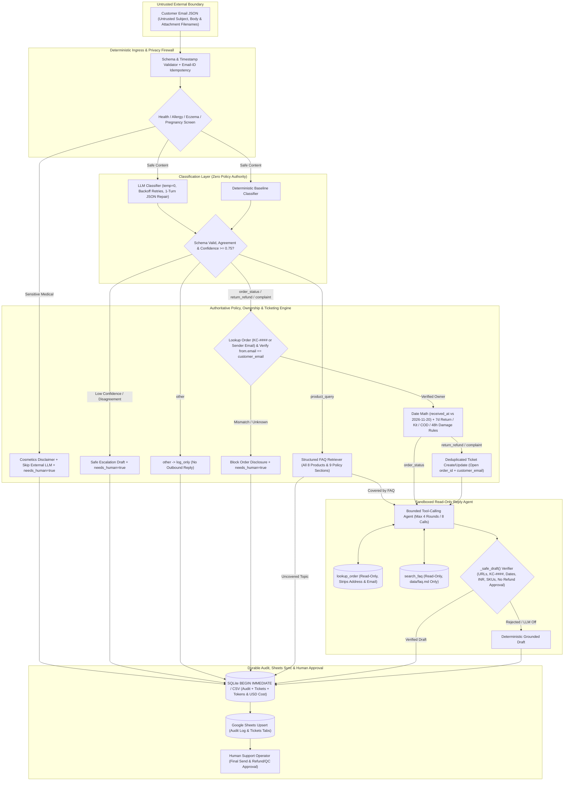

# Architecture and Trust Boundaries

## 1. End-to-End System Architecture



## 2. Tool-Calling & Grounding Sequence

```mermaid
sequenceDiagram
    participant W as Webhook / Batch Runner
    participant E as Engine (engine.py)
    participant C as LLM Classifier
    participant A as Reply Agent (agent_tools.py)
    participant T as Read-Only Tools (orders.json / faq.md)
    participant S as SQLite & Google Sheets

    W->>E: Inbound Email Payload
    E->>E: Validate schema, check idempotency & screen medical PII
    opt LLM Classification Enabled & Non-Medical
        E->>C: Subject + Body + JSON Schema (temp=0)
        C-->>E: Structured JSON (or 1-turn Auto-Repair on schema error)
        E->>E: Cross-check intent & order_id against deterministic baseline
    end
    E->>E: Enforce sender == customer_email & compute days_since_delivery
    opt Return/Refund or Complaint
        E->>E: Create ticket or update open ticket for order_id
    end
    opt Agent Tools Enabled
        E->>A: Task context + untrusted email (no customer address PII)
        A->>T: Call lookup_order(order_id) and/or search_faq(query)
        T-->>A: Verified non-PII order fields / approved FAQ lines
        A-->>E: Proposed customer draft (en / hi / hinglish)
        E->>E: Run _safe_draft() entity check (URLs, KC-####, dates, INR, SKUs)
    end
    E->>S: Commit Audit Row + Ticket + Token/Cost Telemetry
    S-->>W: 200 OK (Draft stored; human reviews risky/ticketed cases)
```

## 3. Trust Boundaries

- **Customer content:** `subject` and `body` are untrusted input. Embedded prompt injections (`E12`) cannot register tools, alter `needs_human`, lower ticket priority, or approve refunds.
- **LLM provider:** Optional (`ENABLE_LLM_CLASSIFICATION`, `ENABLE_AGENT_TOOLS`). Sender name/email and attachment filenames are omitted from prompts, and health/allergy/pregnancy/skin-condition messages (`E20`) are never sent to external LLM endpoints.
- **Order ownership:** Server-side checks require exact case-insensitive match between `from.email` and `order.customer_email` before returning order status, items, totals, or tracking links (`E07`). Shipping street addresses are stripped even for verified owners.
- **Read-only tool allow-list:** Only `lookup_order` and `search_faq` exist. Unknown tool names return `tool_not_allowed`. No write/refund/cancel/send tools exist.
- **Entity-level draft guardrail (`_safe_draft`):** Verifies that every URL, `KC-####` ID, `YYYY-MM-DD` date, ₹/INR/Rs currency figure, and catalog product name in an LLM draft is backed by tool outputs, while allowing natural English, Hindi, and Hinglish phrasing.
- **Dual deployment artifacts:** [`workflow/kesar_order_support_copilot_n8n.json`](../workflow/kesar_order_support_copilot_n8n.json) mirrors the exact Python architecture using native n8n Webhook, Code, LangChain Structured/Auto-Fixing Output Parser, AI Agent, Tool, Switch, and Google Sheets nodes.
